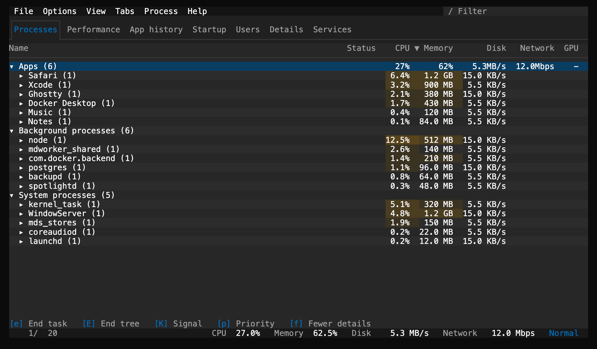
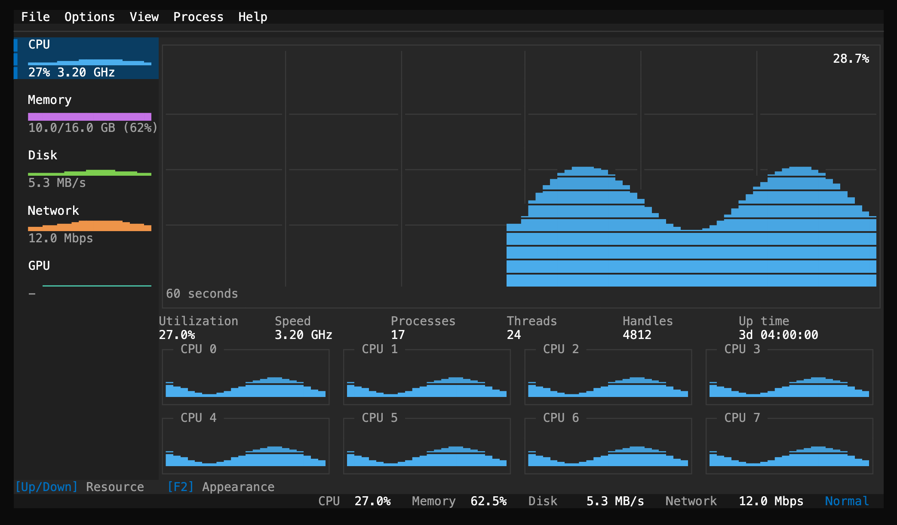

# taskmgr

A Windows 10 Task Manager clone for Linux and macOS terminals. Seven tabs, the
Windows 10 and modern terminal themes, a grouped process table, and 60 second
graphs, driven from the keyboard or the mouse.

## Screenshots

Processes, in the Windows Dark theme:



Performance, in the Phosphor theme:



The sample below is the same layout at 100 columns:

```
 File  Options  View  Tabs  Process  Help                              / Filter
┌─────────┐
│Processes│ Performance  App history  Startup  Users  Details  Services
┘         └─────────────────────────────────────────────────────────────────────────────────────────
Name                                              Status    CPU ▼ Memory       Disk   Network  GPU
────────────────────────────────────────────────────────────────────────────────────────────────────
▾ Apps (6)                                                  27%      62%    5.3MB/s  12.0Mbps    -
  ▸ Safari (1)                                             6.4%   1.2 GB  15.0 KB/s
  ▸ Xcode (1)                                              3.2%   900 MB   5.5 KB/s
  ▸ Ghostty (1)                                            2.1%   380 MB  15.0 KB/s
▾ Background processes (6)
  ▸ node (1)                                              12.5%   512 MB  15.0 KB/s
  ⋮
[e] End task   [E] End tree   [K] Signal   [p] Priority   [f] Fewer details
    1/  20            CPU  27.0%   Memory  62.5%   Disk    5.3 MB/s   Network   12.0 Mbps   Normal
```

## Install

### Prerequisites

- Rust 1.85 or newer with `cargo`. The crate uses the 2024 edition.
- A terminal at least 40x12. 100x30 is comfortable.
- Linux: systemd for the Services and Startup tabs, `who` for the Users tab, and
  `/proc` for sampling. `pkexec` or `sudo` is only needed for elevation.
- macOS: launchd for Services and Startup, and the system administrator prompt for
  elevation.
- A Unicode font for box drawing and block characters. Pass `--ascii` if it lacks
  them.

### Build

```sh
git clone https://github.com/mjbeswick/task-manager-tui.git
cd task-manager-tui
cargo build --release
```

### Install the binary

Either copy the release binary somewhere on `PATH`:

```sh
mkdir -p ~/.local/bin
install -m755 target/release/taskmgr ~/.local/bin/taskmgr
```

Or let Cargo put it in `~/.cargo/bin`:

```sh
cargo install --path .
```

Make sure the directory you chose is on `PATH`:

```sh
echo "$PATH" | tr ':' '\n' | grep -E '\.local/bin|\.cargo/bin'
```

### Verify

```sh
taskmgr --version
```

That prints `taskmgr 0.1.0`. `taskmgr --once` renders a single frame and exits,
which is a quick way to check fonts and colours without a live session.

### Uninstall

```sh
cargo uninstall task-manager-tui   # if installed with cargo install
rm ~/.local/bin/taskmgr            # if installed by copying
```

Settings and history survive an uninstall. Delete them from the paths in
[Where data lives](#where-data-lives) if you want a clean slate.

## Run

```sh
taskmgr
```

| Flag | Meaning |
|---|---|
| `--tab <name>` | Open `processes`, `performance`, `app-history`, `startup`, `users`, `details`, or `services` |
| `--theme <name>` | `light`, `dark`, `nord`, `gruvbox`, `phosphor`, `amber`, `tokyo-night`, `catppuccin`, `solarized-light`, or `rose-pine` for this run |
| `--chart-style <name>` | `filled`, `line`, `dots`, or `blocks` for this run |
| `--interval <speed>` | `high` (0.5 s), `normal` (1 s), `low` (2 s), `paused` |
| `--ascii` | ASCII glyphs instead of box drawing and blocks |
| `--color <depth>` | `auto`, `truecolor`, `256`, or `16`. Auto reads `COLORTERM` and `TERM` |
| `--once` | Render one frame, print it, exit. Useful without a terminal |

### Colours look wrong

Auto detection picks truecolor when `COLORTERM` says so, 16 colours on the
Linux console, and 256 colours everywhere else. Over SSH `COLORTERM` is often
dropped, so force it with `--color truecolor` if your terminal supports it.
If graph blocks show as boxes or question marks, your font lacks them. Use
`--ascii`.

## Keys

| Key | Action |
|---|---|
| `q`, `Ctrl+C` | Quit |
| `F10`, `Alt+F`/`Alt+O`/`Alt+V`/`Alt+T`/`Alt+P`/`Alt+H` | Menu bar, arrows navigate, Enter activates |
| `F1` | Keyboard help |
| `F2` | Appearance: theme, chart style, chart colour, chart gradient |
| `F4` | Show or hide shortcut hints |
| `F5` | Refresh now |
| `1`-`7`, `Tab`, `Shift+Tab` | Switch tabs |
| `Up`/`Down` or `j`/`k`, `PgUp`/`PgDn`, `Ctrl+d`/`Ctrl+u` | Move and scroll |
| `g` / `G`, `Home` / `End` | Top and bottom |
| `Enter` | Open process details, or expand a group |
| `Left`/`Right`, `h`/`l` | Collapse, expand, inspect |
| `<` `>` `r` | Sort column, reverse |
| `/`, `Ctrl+F` | Filter the list. `Enter` keeps the filter, `Esc` clears it |
| `Delete`, `e` | End task |
| `E` | End process tree |
| `x` | Clear the selected app history entry |
| `K` | Send a signal: TERM, KILL, INT, HUP, STOP, CONT, optionally to the tree |
| `f` | Fewer details |
| `t` | Next colour theme |
| `+` `-` | Update speed |
| `p` | Set process priority as a nice value from -20 to 19 |
| `a` | Set affinity, unavailable on both platforms |
| `?` | Keyboard help |
| `Space` | Enable or disable a startup entry, expand a process group |
| `s` `S` `R` | Start, stop, restart a service |

Help > About shows the version, platform, active theme and colour depth, and where the
settings and usage history live. The Tabs menu lists all seven tabs, so every tab stays
reachable when a narrow terminal drops strip labels.

## Menus

- **File** - Run command..., Clear app history..., Exit.
- **Options** - update speed, shortcut hints, fewer details, optional columns, and
  Appearance. Speed shows a radio and each toggle shows a check.
- **View** - refresh, sort, and expand or collapse all.
- **Tabs** - all seven tabs with their `1`-`7` keys.
- **Process** - end task, end tree, signals, priority, and properties. Items that cannot
  act on the current tab are muted with a reason.

Every item shows its key at the right edge. Items in a group are separated by a rule,
and clicking an open menu label closes it. The help panel scrolls with Up/Down and
PgUp/PgDn, so every key is reachable even at 40x12.

## Filter

Every list tab has a filter field at the right of the menu bar. Press `/`, `Ctrl+F`, or
click it, type, and press `Enter`. Matches are case-insensitive and the matching
part of each name is highlighted. Each tab keeps its own filter.

## Mouse

Mouse capture is on. Click a tab to switch, a menu label to open it, a menu item to
activate it, a table row to select it, or a resource in the Performance rail to show
it. Click a row twice to expand or inspect it. Dialog buttons respond to clicks.
Click a column header to sort by it, and click it again to reverse. Click the filter
field to type a filter, or its `×` to clear it. Every action still has a key.

Clicking outside an open menu closes it, and that click is consumed, so it cannot
select a row, switch a tab, or start a filter. Clicking the dropdown's border or empty
space leaves the menu open.

The wheel acts on what is under the pointer. Over a table it moves the viewport three
rows without moving the selection; over the Performance rail it moves the selected
resource; over an open menu it moves the highlight. Long lists show a one-column
scrollbar at the right edge. Drag its thumb to move through the list, or click the
track above or below the thumb to page by one screen. Below 60 columns the bar is
dropped and the position counter in the status bar takes over.

## Tabs

- **Processes** - CPU, Memory, Disk, and Network cells shade from pale yellow
  to red by their share of the system total. The Apps heading row carries the
  system totals in the numeric columns, so the header stays one row. Rows group
  under Apps, Background processes, and
  System processes. App rows collapse by default; expanding one lists its processes. While you move
  the selection the row order holds for two seconds, so the list does not re-sort
  under the cursor; values keep updating. End task asks before touching a system
  process or another user's process.
- **Performance** - CPU, Memory, Disk, Network, and GPU panels with a bordered
  60 second graph, stat boxes, and one bordered graph per logical processor.
  Per-processor charts are hidden when the panel cannot give each cell at least
  four rows and ten columns, so a small terminal keeps the main graph readable.
  A full history always spans the whole plot, whatever the terminal width.
  Percentage graphs keep a fixed 0-100 scale, so a quiet graph looks quiet. Disk
  and network graphs scale to the largest value in the window and label that
  maximum. Filled charts use a gamma-correct colour ramp, line and dot charts take
  the colour of the highest sample in each braille cell, and resampling interpolates
  when the plot is wide and keeps peaks when it is narrow. Options > Appearance, or F2,
  switches between Filled, Line, Dots, and Blocks rendering, chart colours Teal, Blue,
  Orange, Magenta, Mono, or Theme, and turns chart gradients on or off. Blocks fills with quadrants, eighth blocks, and
  half-cell triangles to draw a sloped area edge. Per resource takes five distinct colours from the
  active theme, one per resource.
- **App history** - CPU time, peak memory, and disk totals per application,
  accumulated across restarts. `x` clears the selected entry.
- **Startup** - login agents from launchd or XDG autostart, with their real
  enabled state.
- **Users** - sessions from `who`, with each user's CPU, memory, and disk totals.
- **Details** - every process with PID, status, owner, and priority.
- **Services** - launchd jobs or systemd units, start, stop, and restart. System-scope actions offer per-action elevation.

## Administrator rights

System services, and processes owned by another user or root, need elevation. The app never
runs the whole interface as root. It elevates only the one command:

- macOS uses the system administrator prompt.
- Linux uses `pkexec` when available, then `sudo -n`, then a masked password field that
  feeds `sudo -S` once.
- The password is never written to settings, history, logs, or the screen.
- Cancelling or failing changes nothing.

Signalling a process tree elevates every descendant in one `kill` command, so a
half-delivered tree cannot happen.

## Themes and table readability

The theme collection holds Windows Light, Windows Dark, Nord, Gruvbox Dark, Phosphor,
Amber, Tokyo Night, Catppuccin Mocha, Solarized Light, and Rosé Pine. `t`, the Appearance
dialog, and `--theme` cycle through them in that order.

List tables alternate a slightly lighter or darker row background so a wide row is
easier to follow across its columns. Processes escalate cell shading through 1, 3, 8,
20, and 40 percent of the system total, ending in red. Status words carry meaning
beyond their text: Not responding is red, Suspended and Stopped are amber, service
Running is green, and service Stopped is muted. A selected row always uses the
selection colour, so the stripe and the status tone never compete with it. Every tab
names its own keys in a line at the bottom of its content, and `F4` hides that line.
One continuous line runs beneath the tabs. The active tab
is drawn as an open box with box characters: a top border, vertical sides, and outward
`┘` `└` corners that join the line, with an empty bottom. The 1-7 keys still jump to a
tab even though the digits are not printed. Its label and box use the accent colour. The
box costs one extra chrome row.

## What each platform reports

Anything a platform does not expose shows `-`. It is never a zero.

| Figure | Linux | macOS |
|---|---|---|
| Per-process CPU, memory, disk I/O | yes | yes |
| Per-process GPU | no | no |
| Per-process network | no | no |
| Processor affinity | no | no |
| Handle count | open file handles from `/proc/sys/fs/file-nr` | no |
| Compressed memory | no | no |
| Link speed | no | no |
| Disk active time | no | no |
| Startup impact | Not measured | Not measured |

Why: neither kernel attributes network or GPU work to a process through an
interface this application uses, and neither offers process affinity portably.
Startup impact needs a login-time measurement that this application does not do,
so it reports the same "Not measured" value Windows 10 can show.

## Where data lives

Both paths come from the platform's standard directories.

| File | Linux | macOS |
|---|---|---|
| Settings | `~/.config/task-manager-tui/settings.toml` | `~/Library/Application Support/task-manager-tui/settings.toml` |
| App history | `~/.local/share/task-manager-tui/history.json` | `~/Library/Application Support/task-manager-tui/history.json` |

History is versioned JSON, written to a temporary file and renamed, so an
interrupted write leaves the previous copy readable. A corrupt file is moved
aside and the application starts with an empty history. Records unseen for 30
days are dropped. Clear it with File > Clear app history.

## Services and startup backends

- **macOS**: `launchctl list` for jobs, `launchctl print-disabled` for startup
  state, `kickstart` to start, `kill SIGTERM` to stop, `kickstart -k` to restart,
  `enable`/`disable` for startup entries. Jobs are never unloaded.
- **Linux**: one `systemctl show --all --type=service` call for the unit list,
  `systemctl --user` for user units, and desktop files in `~/.config/autostart`
  and `/etc/xdg/autostart` with a user override for disabling.

Every command is executed as a program plus an argument vector. Nothing goes
through a shell, so a unit name with spaces or quotes cannot become a second
command. An action that needs root is elevated as a single command, with the
platform helper described above.

## Development

```sh
cargo fmt --check
cargo clippy --all-targets -- -D warnings
cargo test
```

Golden frames live in `tests/snapshots/` with `insta`. After an intentional
visual change, regenerate with `INSTA_UPDATE=always cargo test --test render`,
then read the diff before committing.

The screenshots are rendered from the `Snapshot::fixture()` demo data, not from a
live machine:

```sh
cargo run --example screenshot -- processes dark docs/screenshots/processes.png
cargo run --example screenshot -- performance phosphor docs/screenshots/performance.png
```

Sampling budget, measured on an M1 with 608 processes in release mode: worst
refresh 65 ms, well inside the one second interval. The sampler thread skips a
tick rather than queueing one when a sample overruns.

## Known gaps

- Windows is not a target.
- No per-process network or GPU numbers, and no affinity control.
- Startup impact stays "Not measured".
